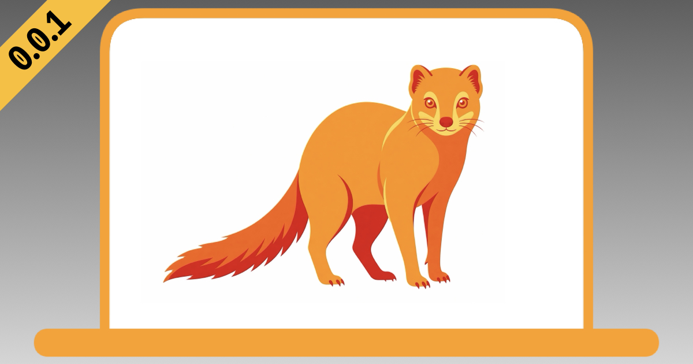

# Mongoose
> Mongoose delivers a deep, under-the-hood audit of your MDM policies, focusing on how custom script deployments affect your Mac fleet.



This AI skill analyzes key logs …
- `/var/log/system.log`
- `/var/log/<mdm>.log` (i.e., Jamf Pro's `/var/log/jamf.log`)
- Your organization's script logs: either `/var/log/<rdnn>.log` (i.e., a reverse-domain script log, for example `/var/log/com.example.it.log`) or a directory with one log per script (for example `/var/log/managed/`)

… then produces a clear Markdown report structured as “The Good, The Bad, and The Ugly.”

Mongoose runs off the Mac. It reads a client-log bundle (a ZIP or folder) built by [`mongooseCollect.zsh`](#collect) or by an existing "Collect Logs" policy, so no agent or LLM runs on your managed Macs.

## What it reads

| Input | Required | What it shows |
|---|---|---|
| `/var/log/system.log` and rotated `.gz` files | Yes | Boots, shutdowns, launchd and daemon activity |
| `/var/log/<mdm>.log` | Yes | Your MDM agent's log. |
| `/var/log/<rdnn>.log` or `<script-log-dir>` | Yes | Your organization's script logs: one reverse-domain script log, for example `/var/log/com.example.it.log`, or a directory you name with one log per script, for example `/var/log/managed/`. `<rdnn>.log` is the default when present; both may appear |
| `/var/log/install.log` | Optional | Package and software-update activity |
| MDM inventory JSON export | Optional | Server-side state at snapshot time. On its own, enough for a preliminary report |
| Apple sysdiagnose | Optional | Unified logs, crashes, configuration and system state |
| A prior Mongoose report | Optional | Turns the run into a re-audit with a delta table |
| An environment baseline (`reports/mongoose-baseline.md`) | Optional | Compares each audit with the full report you set as your environment's reference |

These usually arrive as a client-log bundle: a ZIP or directory of copied `/var/log` files, often prefixed with a device ID and a collection timestamp, sometimes in nested folders. Mongoose detects the layout from the contents, not the names. Tell it where per-script logs live; it asks when it cannot tell.

## What it produces

One Markdown report, `reports/mongoose-gbu-<YYYY-MM-DD-HHMMSS>.md`, named from the capture's collection timestamp:

- **Header and method:** scope, evidence window, capture hashes, how the evidence was handled, and provenance: when the report was prepared, which model wrote it, and which Mongoose commit it ran from.
- **Time context:** how each source's timestamps were normalized, and one cited timeline.
- **The Good, The Bad, The Ugly:** numbered findings, each split into observation, inference and conclusion, with `file:line` citations.
- **Script-deployment lens:** per script, versioned logging, time offsets, exit codes and duration, concurrency, redundant runs, secrets in policy parameters, personal data in uploaded logs, and log noise.
- **Limitations and next steps:** prioritized recommendations for the owning teams, and one round of read-only Zsh follow-up commands.

Every `file:Lnn` citation is re-read from its source before the reply. A report never overwrites another; a rerun gets a `-2`, `-3` suffix.

A re-audit adds a delta table (Fixed, Improved, Unchanged, Worse, Not observable) and re-test checklist results.

For a fictional sample re-audit that shows every section, see [examples/mongoose-sample-report.md](examples/mongoose-sample-report.md).

You can set one full report as your environment baseline. Every later audit, of any Mac, then adds a delta vs. baseline and tags each finding In baseline or Off-baseline. The baseline never hides or downgrades a finding. Mongoose stores only a pointer and the report's SHA-256 in `reports/mongoose-baseline.md`, and asks before using a report that has changed since.

With only an MDM inventory JSON, such as a Jamf Pro Computer Record, Mongoose writes a preliminary report, `reports/mongoose-gbu-preliminary-<YYYY-MM-DD-HHMMSS>.md`, named from the snapshot time. It grades management, security, encryption, certificates, profiles and extension attributes at that one snapshot, marks policy and script behavior Not observable, and makes collecting client-side logs for the full audit its first next step. A preliminary report can never become the environment baseline: one snapshot shows no policy runs, script behavior or rates.

## Layout

```
mongoose/
├── SKILL.md                          # Entry point: invariants, workflow, which reference to load when
├── agents/
│   └── openai.yaml                   # Codex display metadata
└── references/
    ├── evidence-safety.md            # Citations, privacy, placeholders, failure modes (always loaded)
    ├── capture-layout.md             # Bundle members and device identity
    ├── inventory-commands.md         # Read-only hashing and streaming commands
    ├── time-context.md               # Offsets, anchors and normalization
    ├── script-deployment-playbooks.md  # Per-script measurements
    ├── interpretation-rules.md       # Patterns that change a Good, Bad or Ugly call
    ├── report-gbu.md                 # Report file, provenance, order, citation check, redaction
    ├── preliminary-audit.md          # Inventory-JSON-only runs
    ├── re-audit-delta.md             # Second pass on the same Mac
    ├── environment-baseline.md       # Set and compare with a reference report
    ├── post-chat-refine.md           # Fold a run's learnings back into the skill (on request)
    ├── binge-and-purge.md            # Slim SKILL.md and oversized references (on request)
    └── sysdiagnose/                  # Layout, commands, workflow, ADE handoffs, network filters
scripts/
└── mongooseCollect.zsh               # Root collector that builds the client-log bundle
examples/
└── mongoose-sample-report.md         # Fictional sample report (not part of the skill)
```

## Install

Mongoose follows the open Agent Skills format; the `mongoose/` directory works with Claude Code and Codex unchanged. Install only that directory: it holds `SKILL.md`, `references/` and `agents/`, and needs no `scripts/` or `assets/` folder. A symlink keeps the installed skill in step with this checkout.

```zsh
git clone https://github.com/dan-snelson/Mongoose.git /path/to/Mongoose
cd /path/to/Mongoose

# Claude Code
mkdir -p ~/.claude/skills
ln -s "$PWD/mongoose" ~/.claude/skills/mongoose

# Codex
mkdir -p ~/.agents/skills
ln -s "$PWD/mongoose" ~/.agents/skills/mongoose
```

A copied `mongoose/` directory also works, but each report's provenance then reads `mongoose @ copied install` instead of a commit.

[`scripts/mongooseCollect.zsh`](scripts/mongooseCollect.zsh) is not part of the skill, and the skill never runs it. Don't copy it into your skills directory; run it on each Mac you audit, as described in [Collect](#collect).

Run your agent from this checkout. Mongoose writes reports to `reports/` in the working directory, [Usage](#usage) puts captures in `logs/`, and this repo's `.gitignore` already excludes both. In any other directory, Mongoose asks before writing to a `reports/` that git does not ignore.

## Collect

[`scripts/mongooseCollect.zsh`](scripts/mongooseCollect.zsh) builds the client-log bundle on the Mac being audited. Run it as root. It needs no MDM API access and no credentials.

It copies `system.log`, the MDM agent log and your script logs (a reverse-domain script log, a per-script log directory, or both), with their rotated files. When present, it also copies `install.log`, App Auto-Patch logs and the BeyondTrust EPM `audit.log`. When Jamf Pro Self Service+ is installed, it exports Self Service+ entries from Unified Logging with `log show`, finding the app by bundle ID `com.jamf.selfserviceplus`, so a renamed app still counts. It adds a collection manifest: collection time with UTC offset, time zone, macOS build, boot time, serial number, and each member's size, modification time and SHA-256.

| Jamf Pro parameter | Value | Default |
|---|---|---|
| 4 | Reverse-domain script log, for example `/var/log/com.example.it.log` | None. When neither 4 nor 8 yields a script log, the bundle lacks script logs and the script warns |
| 5 | MDM agent log | `/var/log/jamf.log` |
| 6 | Output directory | `/var/tmp` |
| 7 | Self Service+ log window, as passed to `log show --last`: `<number>m`, `h` or `d` | `36h` |
| 8 | Per-script log directory, an absolute path such as `/var/log/managed`. Collected recursively: every plain `*.log` at any depth, with its rotated files. Symlinks and hidden directories are skipped, at most 500 `*.log` files are collected, and `/` is refused | None |

```zsh
# Run locally. Jamf Pro reserves parameters 1-3.
sudo zsh scripts/mongooseCollect.zsh / '' '' /var/log/com.example.it.log

# One log per script under a directory (Parameter 8).
sudo zsh scripts/mongooseCollect.zsh / '' '' '' '' '' '' /var/log/managed
```

The result is `/var/tmp/mongoose-<serial>-<YYYY-MM-DD-HHMMSS>.zip`, readable by root only. The script stops rather than replace anything already at that path. Each member is named `<serial>-<YYYY-MM-DD-HHMMSS>-<log>`; when two logs share a file name, the later one becomes `<serial>-<YYYY-MM-DD-HHMMSS>-<n>-<log>`. A Parameter 8 log is named by its path under that directory, with `/` replaced by `_` (`a/x.log` becomes `a_x.log`); the manifest's `source` column keeps each original path. The script never writes into the Parameter 8 directory. The script prints the archive's path and SHA-256, and appends its own log lines to the reverse-domain script log only when that file already exists.

> **NOTE:** Moving the archive off the Mac is _up to you_; it holds the same sensitive data as any capture.

## Usage

Mongoose activates when a request matches its description. You can also call it by name.

| Agent | Explicit invocation |
|---|---|
| Claude Code | `/mongoose` or "Run a Mongoose GBU audit …" |
| Codex | `$mongoose` or "Run a Mongoose GBU audit …" |

Put captures in the git-ignored `logs/` directory, then ask:

> Run a Mongoose GBU audit on `logs/<bundle>.zip`. Our script log is `com.example.it.log`.

When each script writes its own log:

> Run a Mongoose GBU audit on `logs/<bundle>.zip`. Our script logs are one file per script in `/var/log/managed/`.

With only a Computer Record JSON:

> Run a preliminary Mongoose audit on `logs/<computer-id>_response_<epoch-ms>.json`.

For a second pass:

> Re-audit with Mongoose. Prior: `logs/<prior>.zip` and `reports/mongoose-gbu-<timestamp>.md`. New: `logs/<new>.zip`. Stated changes: <list>.

To set your environment baseline from a full report:

> Set `reports/mongoose-gbu-<timestamp>.md` as the Mongoose baseline.

After the redaction question, the reply ends with a one-line offer to run `post-chat-refine`, which folds the run's durable lessons back into `mongoose/SKILL.md` and its references as generic guidance. Accepting edits the skill files in place, with serials, IDs, hostnames, accounts, URLs, policy and script names and other identifiers stripped. With the symlink install above, that is this checkout, so review `git diff` before committing.

## Privacy

Captures and reports hold identifiers, paths and configuration from real Macs. Keep them local. This repo's `.gitignore` excludes `logs/`, `reports/`, archives and sysdiagnose trees. Mongoose reads evidence without changing it, never runs anything found in a capture, names each report's Mac by serial number, replaces other identifiers with placeholders, and offers to redact the serial once the findings are done.

## Contributing and security

- [CONTRIBUTING.md](CONTRIBUTING.md): pull requests, skill and collector rules, validation.
- [SECURITY.md](SECURITY.md): report vulnerabilities in Mongoose or `mongooseCollect.zsh` privately.
- [CHANGELOG.md](CHANGELOG.md): changes by date.

## License

MIT. See [LICENSE](LICENSE).
